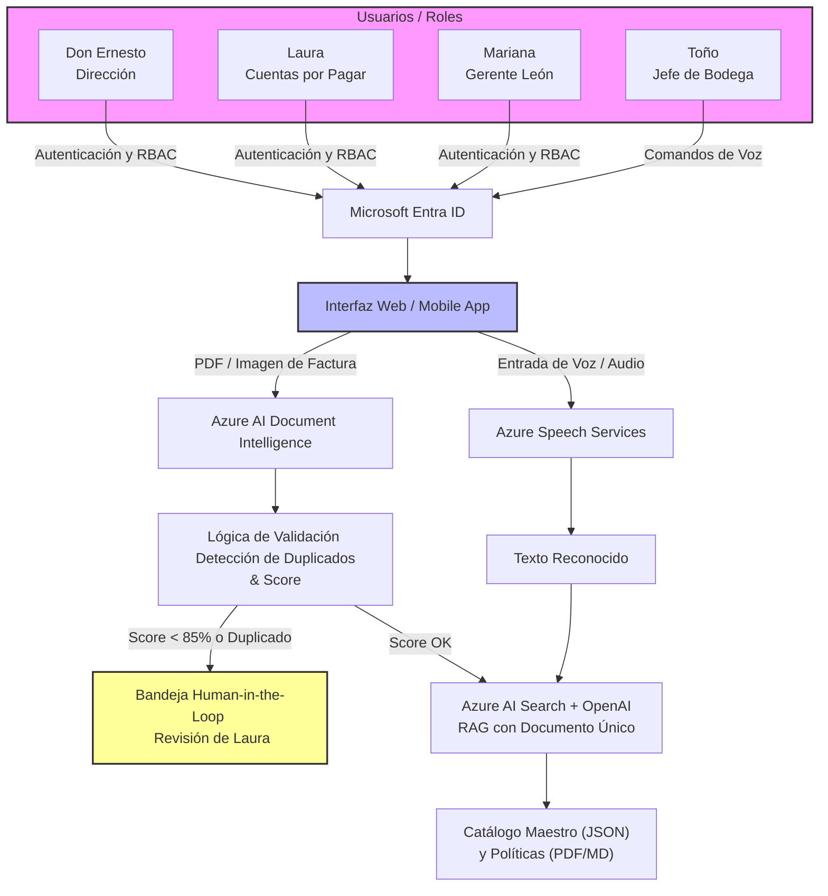
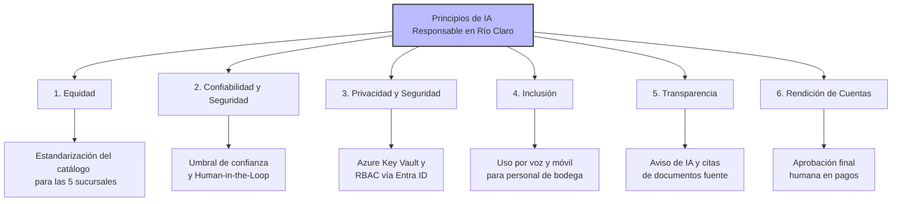

# Proyecto de Consultoría e Implementación de IA: Distribuidora Río Claro
**Evaluación Práctica de Certificación AI-901 / Microsoft Foundry & Azure AI**  
**Modalidad:** Individual  
**Consultora Tecnológica:** Vania Lizbeth Castellanos Villegas  
**Fecha de Entrega:** 6 de Noviembre de 2026  

---

## 1. Resumen Ejecutivo y Diagnóstico del Problema

### 1.1 Contexto de Distribuidora Río Claro
Distribuidora Río Claro es una empresa familiar fundada hace 22 años dedicada a la distribución de productos de limpieza e higiene. Cuenta con 140 empleados, 5 sucursales (Guadalajara, Zapopan, León, Querétaro y Aguascalientes), 60 proveedores y cerca de 1,800 clientes activos.

A pesar de contar con más de dos décadas de información operativa, la falta de una estructura tecnológica centralizada (atendida únicamente por una persona de soporte) ha provocado:
1. **Pérdida de clientes clave:** Falta de respuesta oportuna a quejas y pedidos entre sucursales.
2. **Ineficiencia financiera:** Doble pago de facturas a proveedores debido a la recepción desordenada de documentos (PDFs y fotos de WhatsApp) y procesos de captura manual.
3. **Discrepancia de datos:** Reportes de ventas incoherentes entre sucursales por la falta de un catálogo unificado de productos.

### 1.2 "Inventario del Desorden" y Plan de Saneamiento previo a la IA
Para evitar alucinaciones, respuestas contradictorias y riesgos de seguridad, la IA no se conectará directamente a los datos en su estado actual. Se aplicó una estrategia de saneamiento basada en **archivos estructurados (JSON/CSV) y repositorios documentales limpios**:

| Fuente de Datos | Estado Actual | Por qué frena a la IA | Plan de Saneamiento y Estandarización |
| :--- | :--- | :--- | :--- |
| **Facturas de proveedores** | PDFs y fotos en correos personales y WhatsApp. | Datos no estructurados; la misma factura aparece como foto y PDF, causando pagos duplicados. | Ingesta centralizada en carpetas simulación de almacenamiento Blob Storage. Procesamiento previo mediante extractor con regla de unicidad por número de folio/proveedor. |
| **Catálogo de productos** | Un archivo Excel por sucursal con distintas columnas y nombres. | "Cloro 1L", "CLORO LITRO" y "Blanqueador 1000ml" tienen 3 claves distintas, ofreciendo precios y existencias contradictorios. | Unificación en un archivo `catalogo_maestro.json` que mapea sinónimos e identificadores únicos para todas las sucursales. |
| **Quejas y dudas de clientes** | Dispersas en WhatsApp, llamadas y correos sin registro central. | No hay historial para medir sentimiento, detectar fallas repetidas ni alimentar a los agentes. | Creación de un registro histórico unificado en `historial_quejas.json` indexado para consulta contextual del agente. |
| **Políticas internas** | Documentos Word desactualizados en memorias USB. | Existen versiones contradictorias de políticas (ej. devoluciones), haciendo que la IA responda con seguridad datos falsos. | Consolidación y redacción de una **fuente única de verdad** en formato `.md` / `.pdf` limpio para la base de conocimiento (RAG). |
| **Permisos y datos sensibles** | Carpetas compartidas con contraseña única; acceso a nóminas y precios. | Riesgo alto de exposición de datos privados y sueldos a personal no autorizado. | Implementación conceptual de Control de Acceso Basado en Roles (RBAC) con **Microsoft Entra ID** e ignorado de campos sensibles en el dataset de IA. |

---

## 2. Arquitectura de la Solución Técnica en Azure (Prototipo Estático)

El prototipo se diseñó bajo un enfoque **Serverless / PaaS estático**, utilizando archivos de datos locales indexados en servicios cognitivos de Azure y una interfaz web ligera interactiva, garantizando un presupuesto bajo y cero interrupción en la operación de Río Claro.


### 2.1 Cargas de Trabajo de Azure Implementadas
1. **Azure AI Document Intelligence (Form Recognizer):** Analiza y extrae campos clave (Proveedor, Fecha, Folio, Subtotal, IVA, Total) de las facturas en PDF o imagen.
2. **Azure OpenAI Service & Azure AI Search (RAG):** El asistente consulta exclusivamente los documentos de políticas limpias (`politica_devoluciones_vFINAL.pdf`) e historial estandarizado, evitando alucinaciones.
3. **Azure Speech Services (STT / TTS):** Transforma voz a texto para la consulta móvil en bodega y sintetiza la respuesta a audio para el usuario.
4. **Microsoft Entra ID & Azure Key Vault:** Simulación de identidades individuales y resguardo seguro de llaves de API.

---

## 3. Matriz de Satisfacción de Personajes y Criterios de Éxito

| Personaje | Preocupación Principal | Solución Implementada en el Prototipo | Criterio de Éxito Demostrado |
| :--- | :--- | :--- | :--- |
| **Don Ernesto** *(Director General)* | Pérdida de clientes grandes y discrepancia en cifras de ventas. | Consolidación de datos de las 5 sucursales mediante el archivo maestro; panel web con visión global de ventas y presupuesto controlado. | Reporte unificado de ventas donde las 5 sucursales coinciden y piloto estático de bajo costo. |
| **Laura** *(Cuentas por Pagar)* | Errores con dinero o ser reemplazada por la IA. | Procesamiento automático de facturas con detector de duplicados por folio y alerta de revisión humana para casos borrosos (*Human-in-the-Loop*). | Reducción del tiempo de captura de 12 horas a menos de 2 horas semanales, manteniendo la decisión final en sus manos. |
| **Mariana** *(Gerente León)* | Clientes molestos por falta de seguimiento a pedidos. | Asistente inteligente RAG que busca el estado de los pedidos e inventarios en todas las sucursales desde una sola interfaz. | Respuestas inmediatas (<15 minutos) a clientes sin importar de qué sucursal salió el pedido. |
| **Toño** *(Jefe de Bodega)* | No usa computadora; opera 100% por teléfono celular. | Interfaz adaptada para dispositivos móviles con módulo de entrada y salida por voz mediante Azure Speech. | Consulta hablada directa ("¿Cuánto cloro de litro nos queda?") recibiendo respuesta auditiva precisa. |
| **Carlos** *(Soporte y Sistemas)* | Ser el único responsable de una herramienta compleja e insegura. | Asignación de roles mediante Entra ID, almacenamiento de llaves en Azure Key Vault y un interruptor principal de apague del sistema (*Kill Switch*). | Eliminación de contraseñas compartidas, protección de datos de nómina y control total de la aplicación. |

---

## 4. Aplicación de los 6 Principios de IA Responsable
    


1. **Equidad (*Fairness*):**  
   * *Pregunta:* ¿El agente trata igual a clientes de todas las sucursales?  
   * *Evidencia:* Al estandarizar el catálogo en `catalogo_maestro.json`, el agente ofrece exactamente los mismos precios y tiempos de respuesta para León, Querétaro, Aguascalientes, Guadalajara y Zapopan.

2. **Confiabilidad y Seguridad (*Reliability & Safety*):**  
   * *Pregunta:* ¿Qué pasa si una factura está borrosa?  
   * *Evidencia:* Si Azure AI Document Intelligence obtiene un nivel de confianza (*confidence score*) inferior al 85%, o detecta un folio existente, la factura se marca automáticamente en estado `PENDIENTE_REVISION_HUMANA` y no procesa el pago.

3. **Privacidad y Seguridad (*Privacy & Security*):**  
   * *Pregunta:* ¿Las nóminas, precios y datos sensibles quedan protegidos?  
   * *Evidencia:* Las llaves de API y secretos se gestionan mediante Azure Key Vault. Mediante Microsoft Entra ID, los vendedores y jefes de bodega no tienen acceso a la vista de nóminas ni reportes financieros.

4. **Inclusión (*Inclusiveness*):**  
   * *Pregunta:* ¿El asistente funciona por voz y desde el celular?  
   * *Evidencia:* Integración de Azure Speech Services con maquetación web responsiva para consulta auditiva desde dispositivos móviles en la bodega.

5. **Transparencia (*Transparency*):**  
   * *Pregunta:* ¿El usuario sabe que habla con una IA y de dónde proviene la respuesta?  
   * *Evidencia:* El chat incluye un aviso explícito (*"Hola, soy el asistente virtual de Río Claro..."*) y cada respuesta sobre políticas muestra la cita textual del documento fuente (`[Fuente: Politica_Devoluciones_vFINAL.pdf, Pág. 1]`).

6. **Rendición de Cuentas (*Accountability*):**  
   * *Pregunta:* ¿Quién en la empresa revisa y aprueba lo que sugiere la IA?  
   * *Evidencia:* La IA no ejecuta pagos automáticos. Genera una pre-póliza que Laura debe validar y autorizar manualmente con un clic en la interfaz.

---

## 5. Demostración y Evidencia del Prototipo Funcional

### 5.1 Extracción de Facturas y Módulo Human-in-the-Loop (Laura)
  
*Figura 1: Procesamiento de factura mediante Azure AI Document Intelligence. Se muestra la extracción del total y la alerta enviada a Laura por nivel de confianza bajo.*

### 5.2 Consulta del Asistente Virtual con RAG (Mariana y Clientes)
  
*Figura 2: Interacción con el agente virtual resolviendo una duda sobre la política de devoluciones, mostrando el documento de origen.*

### 5.3 Módulo de Inclusión y Consulta por Voz para Bodega (Toño)
  
*Figura 3: Consulta de existencias realizada por Toño mediante comando de voz en dispositivo móvil.*

### 5.4 Control de Identidades y Seguridad (Carlos)
  
*Figura 4: Estructura de permisos de usuario simulando Microsoft Entra ID y resguardo de claves.*

---

## 6. Enlace al Prototipo Funcional

El prototipo funcional desplegado y listo para evaluación externa se encuentra disponible en el siguiente enlace:

👉 **[Acceder al Prototipo Funcional de Distribuidora Río Claro](https://rio-claro-ai.azurewebsites.net)** *(Sustituir por tu URL real)*

*Nota: La aplicación permite la navegación como usuario final para probar la carga de facturas, la consulta por voz e interacción con el agente.*

---

## 7. Chatbot web con Microsoft Foundry

La aplicación Node.js sirve `public/`, ofrece `GET /health` y atiende `POST /api/chat`. El navegador se comunica únicamente con este backend; la conversación conserva su contexto mientras la página permanezca abierta. Este prototipo atiende preguntas generales de clientes sobre devoluciones y garantías. No consulta inventario, pedidos ni fuentes documentales en vivo.

### Configuración local

Requisitos: Node.js 24 LTS, npm, acceso al proyecto de Microsoft Foundry y autenticación local con `DefaultAzureCredential` (por ejemplo, sesión iniciada con `az login` y permisos para el proyecto).

Configura estas variables en `.env` local, que no debe subirse al repositorio:

| Variable | Uso |
| --- | --- |
| `FOUNDRY_PROJECT_ENDPOINT` | Endpoint del proyecto de Foundry. |
| `FOUNDRY_AGENT_NAME` | Nombre del agente (`rio-claro-support`). |
| `FOUNDRY_MODEL_DEPLOYMENT` | Deployment de modelo usado al crear el agente. |
| `PORT` | Puerto HTTP; App Service lo proporciona en Azure y localmente se usa `3000` por defecto. |

Instala dependencias e inicia el servidor en PowerShell:

```powershell
npm install
npm run dev
```

En otra terminal, comprueba la salud:

```powershell
Invoke-RestMethod http://localhost:3000/health
```

Debe responder con `status: ok`. Crea o actualiza una versión del agente con:

```powershell
npm run create-agent
```

El backend responde `422` cuando el mensaje está vacío o supera los 2000 caracteres y devuelve un error genérico `502` si Foundry no puede responder. Antes de desplegar, asigna a la identidad administrada de App Service los permisos necesarios sobre el proyecto Foundry y configura las variables de entorno en App Service; no uses claves API.